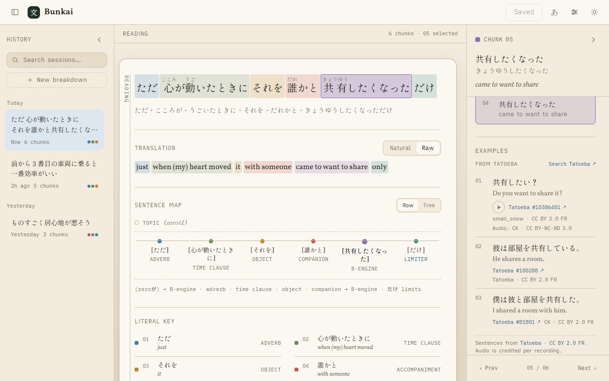

<p align="center">
  
</p>

<h1 align="center">Bunkai</h1>

<p align="center">Read a Japanese sentence, see its pieces.</p>

<p align="center">
  <a href="./docs/README.md">Docs</a> ·
  <a href="./docs/DESIGN.md">Design</a> ·
  <a href="./docs/PLAN.md">Roadmap</a> ·
  <a href="./docs/HANDOFF.md">Status</a>
</p>

<p align="center">
  <a href="https://github.com/GilbertImmanuel/bunkai/actions/workflows/ci.yml">
    
  </a>
  
</p>

<p align="center">
  
</p>

Bunkai is a desktop-first, local-first Japanese sentence breakdown app. Paste a sentence,
see it chunked, and select a chunk to read its role, construction, literal gloss, real
example sentences, and grammar note.

It is a reading desk, not a dictionary, chatbot, flashcard app, or course.

## What you get

- **Chunked reading.** The sentence is the hero. Every chunk has a colour, a role, kana,
  a literal gloss, and a grammar note.
- **A real breakdown sidebar.** Construction steps, examples, and a concise grammar note
  for the selected chunk. Reclick the chunk or press `Esc` to collapse it.
- **Natural and raw translations.** Read the adapted English or the literal chunk-order
  gloss. Natural highlights follow meaning, not English word order.
- **Furigana and sentence maps.** Name and vocabulary readings are independent switches;
  the Cure Dolly-style map shows topic, A-car, B-engine, modifiers, and limiters.
- **Real examples from Tatoeba.** 2–3 attributed corpus sentences with approved English
  translations, source links, and licensed audio where available. Cached locally.
- **Local history.** Sessions live in IndexedDB. Search, reopen, save, and undo without an
  account or a server.
- **Bring your own AI key (optional).** OpenRouter, OpenCode via your proxy, OpenAI, or
  Claude. With no key, the sample and manual modes work fully.
- **Local-first.** No backend, no login, no cloud sync, no analytics. AI keys and sessions
  stay in your browser.

## Quick start

**Prerequisites:** Bun 1.3.14+ and Node 22+. Install Bun from
[bun.sh](https://bun.sh/docs/installation) if needed.

### 1. Get the code

Clone the repository:

```bash
git clone https://github.com/GilbertImmanuel/bunkai.git
cd bunkai
```

Or use **Code → Download ZIP** on GitHub, unzip the archive, and open a terminal in
that folder.

### 2. Run locally

All commands run from the repository root (the folder containing `package.json`).

```bash
bun install
bun run dev
```

Open `http://localhost:5173` and click the sample, or paste a Japanese sentence.

```bash
bun run check       # svelte-check + TypeScript
bun run lint        # ESLint
bun run test        # Vitest
bun run test:e2e    # Playwright (system Chrome by default)
bun run build       # static build in dist/
bun run preview     # preview the build
```

The app is desktop-only. Below 900px it shows a guard instead of a broken layout.

## Project structure

```
├─ src/
│  ├─ lib/
│  │  ├─ ai/          # optional BYO-key providers and breakdown parsing
│  │  ├─ components/  # reading sheet, sidebar, history, settings, examples
│  │  ├─ data/        # types, sample sessions, sentence map, references
│  │  ├─ stores/      # app, history, AI, Tatoeba, toast
│  │  ├─ styles/      # tokens, base, self-hosted fonts
│  │  ├─ tatoeba/     # client, lookup, cache
│  │  └─ utils/       # persistence, history helpers, motion
│  ├─ App.svelte
│  └─ main.ts
├─ tests/e2e/         # Playwright coverage with mocked AI/Tatoeba routes
├─ docs/              # product, design, plan, manifest, handoff, docs index
├─ research/tatoeba/  # verified API and licensing research
└─ public/            # favicon
```

## Local-first notes

- Sessions are stored in **IndexedDB** (`bunkai.sessions`); preferences in `localStorage`.
- AI keys are stored locally under `bunkai.ai` and go directly from your browser to the
  provider you choose. Browser storage is not a vault; use a scoped key.
- Tatoeba examples are fetched directly from `api.tatoeba.org` and cached locally. Only
  the short lookup term is sent. No Bunkai server is involved.
- The sample and manual modes work without any API key.

## Credits

- Example sentences from [Tatoeba](https://tatoeba.org), generally
  [CC BY 2.0 FR](https://creativecommons.org/licenses/by/2.0/fr/). Audio licenses vary per
  recording and are credited in the app. Tatoeba does not endorse Bunkai.
- Fonts self-hosted via [Fontsource](https://fontsource.org): Shippori Mincho, Vollkorn,
  iA Writer Quattro, and iA Writer Mono.
- Built with [Svelte](https://svelte.dev), [Vite](https://vite.dev), and
  [idb-keyval](https://github.com/jakearchibald/idb-keyval).

## Documentation

- [Documentation index](./docs/README.md)
- [Source of truth](./docs/SOURCE_OF_TRUTH.md)
- [Design system](./docs/DESIGN.md)
- [Implementation plan](./docs/PLAN.md)
- [Project manifest](./docs/manifest.md)
- [Living handoff](./docs/HANDOFF.md)
- [Tatoeba research](./research/tatoeba/README.md)

## License

MIT is planned. The `LICENSE` file will be added before the repository is made public.
